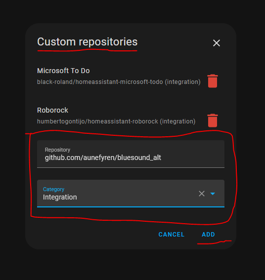
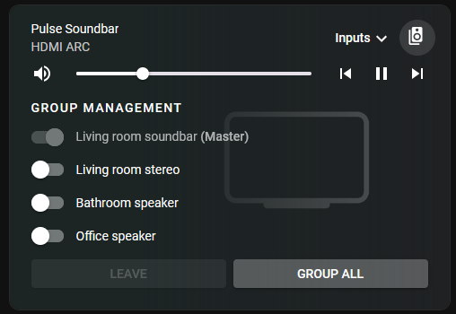

# Alternative Bluesound Integration for Home Assistant


> [!NOTE]
> Parts of this integration were co-written with Claude (Anthropic AI). The code has been reviewed and tested against real Bluesound hardware.

This project is an alternative integration for Bluesound/BluOS speakers, rewritten from scratch using modern Home Assistant patterns.

<br>
<br>

[](https://my.home-assistant.io/redirect/hacs_repository/?owner=aunefyren&repository=bluesound_alt)  
Until it is in the HACS default list, add it as a custom repository first.

<br>
<br>

> [!IMPORTANT]
> This is a full rewrite, not a fork of the official Bluesound integration. It uses the modern HA integration architecture: UI-based setup (config flow), a coordinator per device, and native HA grouping. If you were using the previous version of this integration, you will need to re-add your devices through the UI.

<br>
<br>

## Why not the core Bluesound integration?
Home Assistant ships its own `bluesound` integration. Both run locally and follow the players by long-polling. Compared with core as of Home Assistant 2026.10, this integration:

* **Groups without breaking groups.** Joining from any speaker in a group adds to that group, a speaker leading another group is taken out of it first instead of nesting one group inside another, stereo pairs are refused instead of split, and a join the player refuses shows as an error. Ungrouping works even when the group's leader is not set up in Home Assistant.
* **Keeps grouped speakers useful.** A speaker in a group shows what the group is playing and keeps its playback controls; core shows it as idle.
* **Browses the player's own menus**: inputs, TuneIn, Radio Paradise and BluOS Radio, next to Home Assistant's media sources. Core browses only the latter.
* **Exposes the player's settings** as entities (listening mode, tone controls, bass, treble, balance, subwoofer, volume limits, Bluetooth mode, display and indicator brightness, and more), plus a restart button and diagnostics.
* **Covers more sources and controls**: inputs of receivers with a BluOS module such as the NAD T758, repeat mode, and hiding sources you don't use.
* **Catches up faster**: a player that drops off is retried after 10 seconds (core: 3 minutes), and inputs and presets changed in the BluOS app show up straight away (core: every 15 minutes).

Core has things this doesn't: clear playlist, sleep timer buttons, several players on one device at different ports, and translations beyond English. If you need those, use core.

<br>
<br>

## Main features
* UI-based setup, no `configuration.yaml` editing required, with players on the network discovered automatically
* Correct group join/unjoin with immediate state updates
* Per-speaker volume control within groups (individual volume, not just group volume)
* Group state works with groups of any size
* Source/input selection (physical inputs, streaming services, presets, and the inputs of receivers such as the NAD T758), with unused sources hideable per player
* Media browsing of the player's inputs, TuneIn, Radio Paradise and BluOS Radio menus
* Shuffle, repeat and seeking (where the track allows it)
* Works with [Mini Media Player](https://github.com/kalkih/mini-media-player) grouping
* Playback, grouping and volume follow the player by long-polling, so changes show up instantly
* Diagnostics, with addresses, names and account details redacted
* Player settings as in the BluOS app: listening mode, tone, balance, subwoofer, output mode, volume limits, Bluetooth mode, indicator and display brightness
* Restart button for every player

<br>
<br>

## Installation instructions

1. Until it is in the HACS default list, add this repo to HACS as a custom repository



<br>

2. Install `Bluesound Alt` in HACS
3. Restart Home Assistant
4. Your players show up under **Settings → Devices & services → Discovered**. Click **Add** on each one
5. A player that is not discovered, on another subnet or VLAN say, can be added by hand: **Add Integration**, search for `Bluesound Alt`, and enter its IP address and port (default: 11000)

<br>
<br>

### Example: Mini Media Player YAML

This integration works with [Mini Media Player](https://github.com/kalkih/mini-media-player) for speaker grouping. Use `platform: media_player` in the `speaker_group` config, this is the correct setting for the modern HA grouping API this integration uses.

```yaml
type: custom:mini-media-player
entity: media_player.c700_amplifier
artwork: material
hide:
  power: true
  icon: true
  source: false
speaker_group:
  platform: media_player
  supports_master: true
  show_group_count: true
  entities:
    - entity_id: media_player.c700_amplifier
      name: Living room stereo
    - entity_id: media_player.pulse_soundbar
      name: Living room soundbar
    - entity_id: media_player.pulse_flex_bathroom
      name: Bathroom speaker
    - entity_id: media_player.pulse_flex_office
      name: Office speaker
```

> [!NOTE]
> Previous versions of this integration used `platform: bluesound` in MMP. This no longer works correctly. Change it to `platform: media_player` with `supports_master: true`.

<br>

Result:



<br>
<br>

## Ideas for further development

* Alarm/sleep timer support
